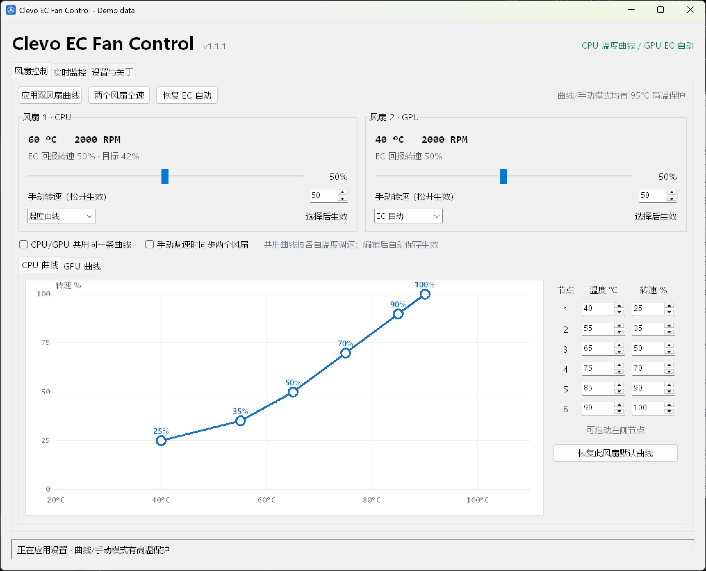
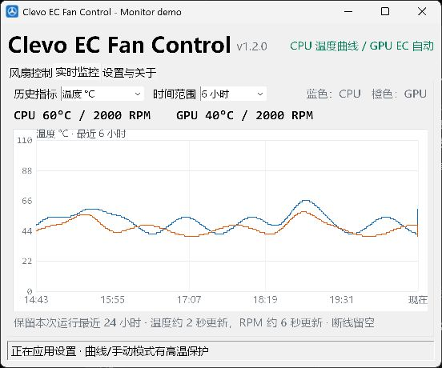

# Clevo EC Fan Control

一款离线、开源的 Windows 笔记本风扇控制工具。程序不依赖厂商控制中心，而是通过 ACPI 嵌入式控制器（EC）读取温度、转速并设置风扇占空比。

> [!WARNING]
> 直接写入 EC 具有机型特异性。当前版本默认只允许已在实机验证的 **HASEE Computer CNP6S**。不要在其他型号上直接运行控制功能，也不要同时运行其他 EC 或风扇控制软件。使用本软件造成的风险由使用者承担。

[下载最新版](https://github.com/jovidalao/clevo-ec-fan/releases/latest) · [更新记录](CHANGELOG.md) · [兼容性与验证范围](docs/compatibility.md)



截图使用模拟传感器数据，仅展示界面。

## 功能

- CPU、GPU 各自选择 EC 自动、温度曲线、手动固定或全速，可混合使用
- 曲线可独立或共用，支持拖动节点和精确输入；有效编辑自动保存，运行中的曲线自动更新
- 共用曲线按 CPU/GPU 各自温度计算，解除共用恢复原有独立曲线
- 手动调速可分别设置，也可勾选同步两个风扇
- 实时温度、占空比、RPM；历史图可选 3 分钟、15 分钟、1 小时、6 小时或 24 小时，带真实时间刻度
- 手动固定转速、双风扇全速、恢复 EC 自动
- 曲线和手动模式均有 95°C 高温强制全速保护，回落至 88°C 后恢复目标；切换设置不会清除高温保护
- 温度读取或控制写入异常时尝试恢复 EC 自动，保留用户模式配置；RPM 超时单独显示未知值，恢复后清除过期报错
- 关闭窗口默认进入系统托盘，托盘提供快速操作
- 登录 Windows 时后台启动，无 UAC 弹窗的当前用户计划任务
- 保存 CPU/GPU 曲线、手动滑块位置、监控选项、窗口尺寸和后台设置
- 普通打开、后台启动均在 EC 就绪后恢复上次各风扇模式，可在设置中关闭
- 无账号、无遥测、无网络请求

## 系统要求

- 64 位 Windows 10/11
- 已验证机型：HASEE Computer CNP6S
- 管理员权限
- 首次运行需要安装随附的 InpOutx64 端口访问驱动

程序默认带有机型保护。`--allow-unsupported` 仅供已经自行验证 EC 协议的开发者使用，不代表其他机型可以安全工作。

## 使用发布版

1. 下载并解压 `ClevoEcFanControl-v1.2.0-windows-x64.zip`。
2. 进入目录，双击 `ClevoEcFanControl.exe`。
3. 在“风扇控制”页设置曲线或手动转速。
4. 点击 `X` 默认缩小到托盘；双击托盘的蓝色风扇图标重新打开。
5. 每张风扇卡片的模式下拉框可单独切换；顶部按钮同时切换两个风扇。
6. 勾选“CPU/GPU 共用同一条曲线”后，两边编辑器同步；勾选“手动调速时同步两个风扇”后，下次手动调整同步生效。
7. 在“设置与关于”页管理开机启动和恢复上次模式。

发布版是便携软件，无需安装 Python。解压目录可以移动，但移动后应重新切换一次开机启动，以更新计划任务中的程序路径。

设置保存在：

```text
%LOCALAPPDATA%\ClevoEcFanControl\settings.json
```

默认记住并恢复每个风扇的模式、曲线和手动目标，包括“CPU 曲线 + GPU 自动”等混合模式。关闭“每次打开时恢复上次 CPU/GPU 模式”后，以 EC 自动启动。托盘菜单中的“退出”会恢复 EC 自动控制，但保留用户选择供下次打开恢复。旧版 `resume_curve` 配置会自动迁移。

升级时，先从托盘菜单退出旧版，再运行新目录内的 EXE。新版本放在独立目录，避免覆盖正在运行的旧版。若已开启开机启动，请在新版设置中关闭后重新开启，以更新计划任务的程序路径。

## 监控范围与通信恢复



在“实时监控”页选择时间范围。默认 15 分钟，本次进程运行期间保留最近 24 小时，范围选择会保存；历史数据不跨退出/重启保存，不会生成温度日志。长时间范围按图像像素保留高低峰值，缺失数据留空。温度约每 2 秒更新一次，RPM 约每 6 秒更新一次。

RPM 读取失败时显示 `--`，温度控制仍可运行。温度失效或控制写入失败时会尝试恢复 EC 自动；恢复通信后会更新状态提示，用户可重新应用保存的曲线或手动模式。应用不会在故障后擅自重新接管控制。

诊断日志保存在配置目录的 `logs/control.log`，单个文件最多 256 KiB，最多保留两个旧文件。日志仅用于记录异常，不包含持续温度记录；反馈问题前请去掉本机路径等个人信息。

## 从源码运行

需要 64 位 Python 3.11–3.13：

```bat
python -m pip install -r requirements.txt
python clevo_fan_gui.py
```

后台启动：

```bat
python clevo_fan_gui.py --background
```

开发者绕过机型保护：

```bat
python clevo_fan_gui.py --allow-unsupported
```

## 测试

```bat
python -m unittest discover -s tests -v
```

测试使用模拟控制器，不打开或写入真实 EC。新增功能的模拟测试不等同于实机验证，详见[验证范围](docs/compatibility.md)。

## 构建发布包

```bat
python -m venv .venv
.\.venv\Scripts\python.exe -m pip install -r requirements-build-lock.txt
.\.venv\Scripts\python.exe build.py
```

构建结果：

- `dist/ClevoEcFanControl-v1.2.0/ClevoEcFanControl.exe`：带图标、版本信息和管理员清单的主程序
- `dist/ClevoEcFanControl-v1.2.0-windows-x64.zip`：完整便携发布包
- 同名 `.sha256`：发布包校验文件

采用 PyInstaller onedir 形式，以缩短启动时间并减少单文件打包带来的误报和驱动路径问题。发布 EXE 未进行商业代码签名，Windows SmartScreen 可能提示未知发布者；公开分发时建议补充可信的代码签名。

## 项目结构

- `clevo_fan_gui.py`：Tkinter 界面、托盘、监控和控制工作线程
- `telemetry_history.py`：带时间戳的 24 小时会话历史和保留峰值的绘图降采样
- `fan_policy.py`：独立风扇模式、温度保护和目标计算
- `tests/test_fan_control.py`：配置迁移、模式恢复、混合控制及故障回退的模拟回归测试（`python -m unittest discover -s tests -v`，不写入真实 EC）
- `clevo_fan.py`：风扇命令、曲线插值和命令行接口
- `ec_probe.py`：带超时的 ACPI EC 读写
- `app_config.py`：配置校验、迁移和原子保存
- `autostart.py`：当前用户登录任务管理
- `platform_guard.py`：机型识别与兼容保护
- `build.py`：PyInstaller 和 ZIP 发布构建

## 开源发布

源码采用 MIT 许可证。发布 GitHub Release 时，建议上传便携 ZIP 和 SHA256 文件，不要上传 `build/`、个人配置或 `__pycache__/`。第三方组件和驱动声明见 [THIRD_PARTY_NOTICES.md](THIRD_PARTY_NOTICES.md)。发布包包含 `source/` 应用源码、第三方许可证及 pystray 对应源码，修改和重建方式见 [third_party/README.md](third_party/README.md)。

本项目与 HASEE、CLEVO 无隶属或背书关系。交互设计参考了主流风扇控制工具的通用使用习惯，未使用其专有代码。

## 参与开发

参见 [CONTRIBUTING.md](CONTRIBUTING.md)、[EC 协议记录](docs/ec-protocol.md)和[问题反馈](https://github.com/jovidalao/clevo-ec-fan/issues)。

## 方案选择

[Fan Control](https://github.com/Rem0o/FanControl.Releases) 提供成熟的曲线和插件交互，但主程序闭源，硬件兼容性依赖底层库或插件。当前未确认其提供 CNP6S 专用适配。[NBFC Revive](https://github.com/UraniumDonut/nbfc-revive) 可通过配置适配笔记本，但仍需验证本机 EC 协议，且维护者说明已不主动开发。本项目因此保留已验证的 CNP6S 协议，参考其独立风扇和共享曲线的操作方式，不引入第二套控制驱动。
